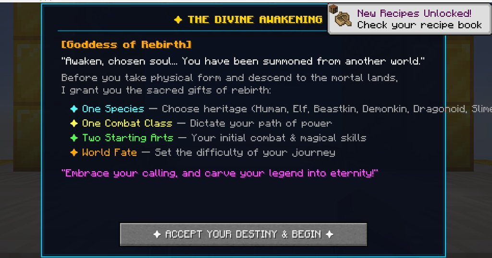
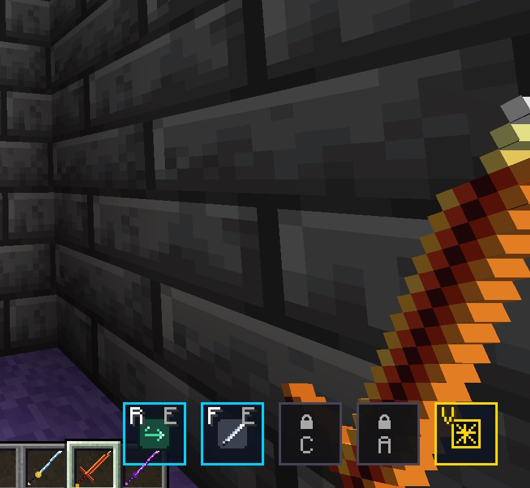
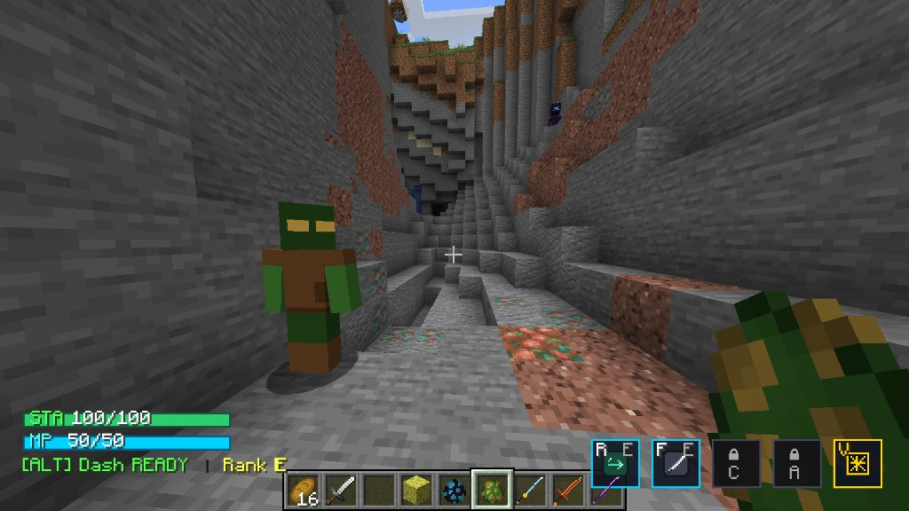
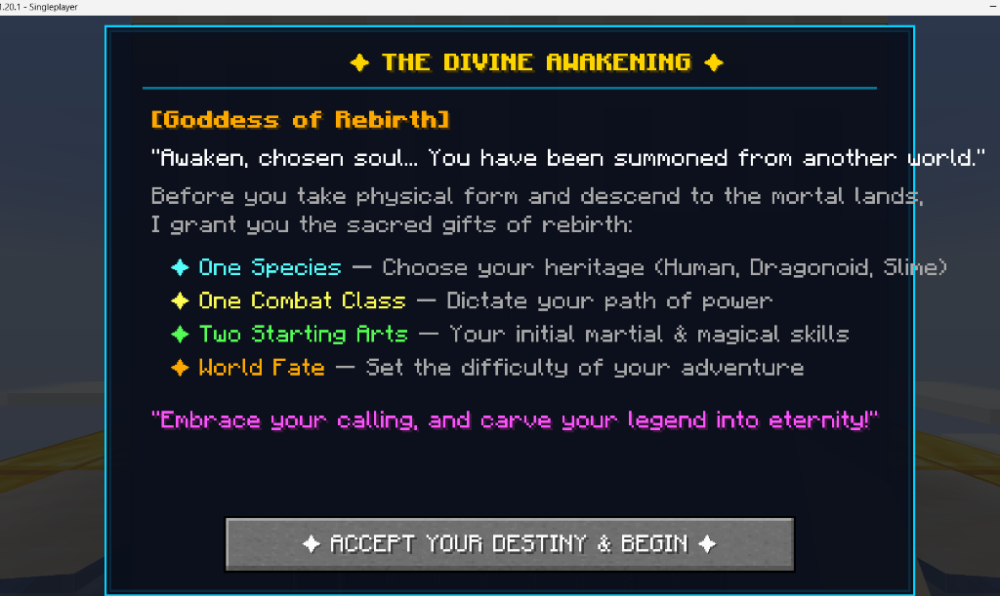
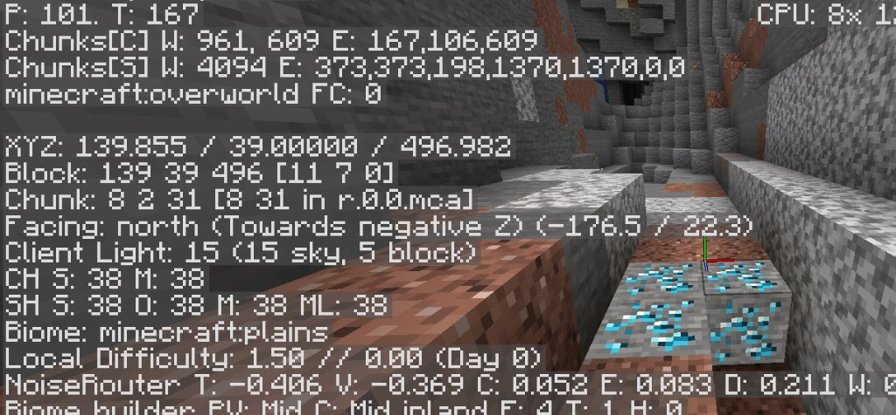
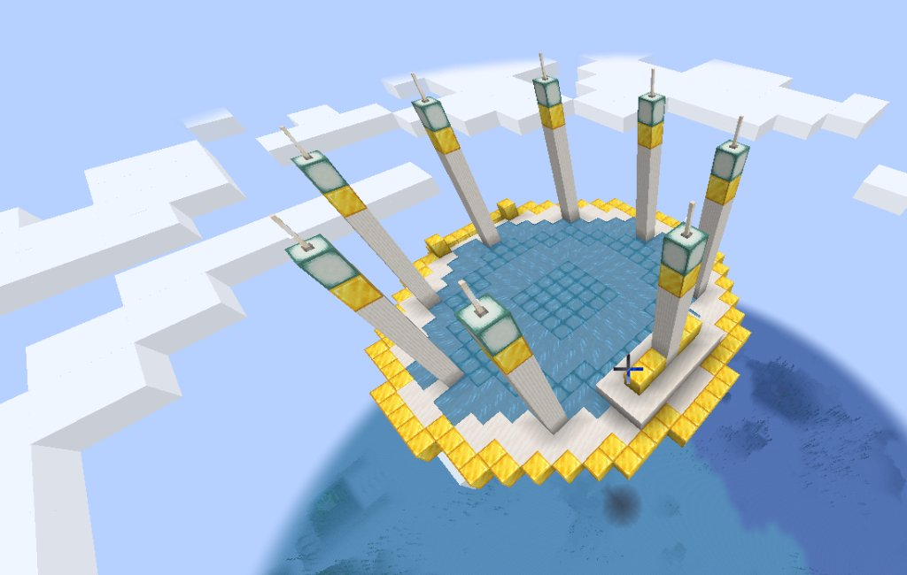
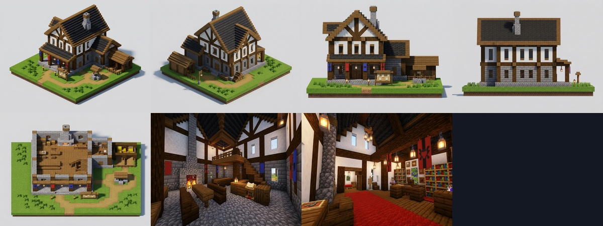
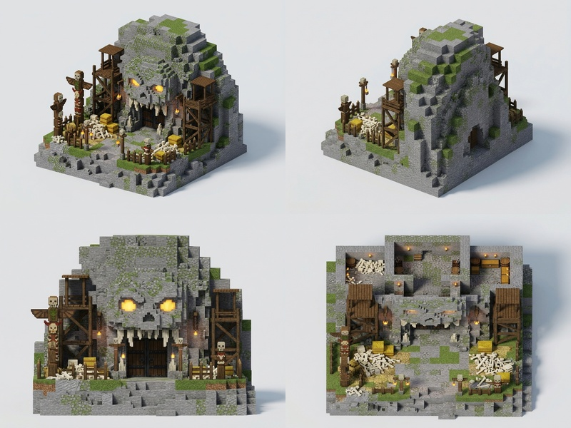

# ASCEND: REALM OF THE CHOSEN — PROJECT PROGRESS & DESIGN REPORT

**Project Name:** Ascend (`ascend`)  
**Target Platform:** Minecraft 1.20.1 (Java Edition)  
**Mod Loader:** Fabric Loader (Loom 1.6.12, Yarn mappings)  
**Distribution Deliverable:** `ascend-0.1.0-alpha.jar` (544 KB)  
**Git Repository:** `https://github.com/patelpratum3820-tech/ascend.git` (`main` branch)  
**Date of Report:** November 1, 2026  

---

## 1. Executive Summary

**Ascend** is an anime/isekai RPG conversion mod for Minecraft 1.20.1. It merges fast-paced action combat, *Solo Leveling*-inspired hunter ranks, active skill hotbars, fluid directional dodging, deep subterranean progression, and rich fantasy species into a cohesive survival experience.

This report documents:
1. Everything built, coded, and verified so far.
2. Every bug, visual flaw, and UI clash encountered during gameplay testing, alongside root-cause analyses and exact code fixes.
3. The architectural challenge of translating AI concept art sheets into in-game Minecraft voxel structures (specifically the **Temple of the Chosen**).
4. Concrete technical proposals and next milestones for world generation, dungeon gates, and adventurer structures.

---

## 2. Completed Features & System Overview

```
                      +-----------------------------+
                      |    THE DIVINE AWAKENING     |
                      |  (Goddess of Rebirth Story) |
                      +--------------+--------------+
                                     |
         +---------------------------+---------------------------+
         |                           |                           |
+--------v--------+         +--------v--------+         +--------v--------+
| 6 FANTASY RACES |         | 5 COMBAT CLASSES|         | 44 RPG SKILLS   |
| Human, Elf,     |         | Swordsman, Tank,|         | Ranks E to SS,  |
| Beastkin, Demon,|         | Mage, Archer,   |         | Cast via Hotbar |
| Dragonoid, Slime|         | Summoner        |         | [R, F, C, X, V] |
+--------+--------+         +--------+--------+         +--------+--------+
         |                           |                           |
         +---------------------------+---------------------------+
                                     |
                      +--------------v--------------+
                      |   COMBAT & PROGRESSION      |
                      |   - Directional Dash (i-frames) |
                      |   - Mana & Stamina Engine   |
                      |   - Skill Unlock Screen     |
                      |   - Ascender's Grimoire GUI |
                      |   - Deepslate Ore Progression|
                      +-----------------------------+
```

### 2.1 The Divine Awakening (Prologue & Creation)
When a player creates or joins a new world:
* They are summoned to the celestial **Temple of the Chosen** at `Y = 220`, floating in the sky.
* The player is protected with high-tier Resistance and Slow Falling so they cannot be harmed.
* An interactive dialogue sequence appears with the **Goddess of Rebirth**, guiding the player through 4 distinct steps:
  1. **Species Choice:** Human, Elf, Beastkin, Demonkin, Dragonoid, or Slime.
  2. **Class Choice:** Swordsman, Tank, Mage, Archer, or Summoner.
  3. **Difficulty (World Fate):** Easy, Normal, Hard, or Nightmare.
  4. **Starting Arts:** Selecting 2 starter Rank E combat arts.
* Upon confirming, triumphant fanfare plays, starter gear is placed into the inventory, and the player descends smoothly to the Overworld below.

### 2.2 The 6 Fantasy Species
Each species possesses unique passive stats, combat affinities, and tactical vulnerabilities:

| Species | Base Stat Modifiers | Unique Passives & Perks | Inherent Weaknesses |
| :--- | :--- | :--- | :--- |
| **Human** | Balanced base stats | **+15% Essence Bonus** from all defeated monsters and dungeon rewards. | None. Standard balanced playstyle. |
| **Elf** | +40 Max Mana, -2 Max Health | **1.5x Passive Mana Regeneration**, +10% Movement Speed. | Frail constitution (-2 max health). |
| **Beastkin** | +3 Strength, +20 Stamina, -15 Mana | **Permanent Night Vision**, +10% Dash Speed, raw feral endurance. | Low magic aptitude (-15 max mana). |
| **Demonkin** | +4 Strength, +20 Mana | **100% Fire & Lava Immunity**, **5% Melee Lifesteal** on all attacks. | +50% extra damage taken from holy & magic sources. |
| **Dragonoid** | +3 Strength, -5% Speed | **100% Fire & Lava Immunity**, Dragon Breath damage bonus. | Cold & Drowning vulnerability (+50% damage). |
| **Slime** | -4 Max Health, -2 Defense | **75% Fall Damage Reduction**, passive health regeneration over time. | Vulnerable to physical heavy blows (-2 Defense). |

### 2.3 The 5 Combat Classes
* **Swordsman:** Stamina-driven rapid combo attacker (+2 Strength, +1 Speed). Focuses on close-range slashes, whirlwinds, and high physical burst.
* **Tank:** Indomitable protector (+4 Defense, +4 Health, -2 Speed). Focuses on crowd control, ground slams, parry guards, and team shields.
* **Mage:** Devastating ranged spellcaster (+30 Mana, -2 Defense). Focuses on fireballs, lightning strikes, frost novae, and meteors.
* **Archer:** Agile sharpshooter (+2 Speed, +1 Strength, -2 Defense). Focuses on longbow velocity, arrow rain volleys, and grapple mobility.
* **Summoner:** Commander of familiars (+20 Mana, -2 Health). Focuses on spirit wolves, shadow soldiers, constructed golems, and undead legions.

### 2.4 All 44 RPG Skills Fully Implemented
Every single skill from `skill_ranks.json` is registered and executable in `AscendSkills.java` with sound effects, particle trails, and cooldowns:

* **Rank E:** `basic_step`, `dash`, `flash_step`, `flame_slash`, `mana_bolt`, `block`, `power_strike`, `enchant`, `reinforce`.
* **Rank D:** `whirlwind`, `frost_nova`, `arrow_rain`, `stone_skin`, `spirit_wolf`, `grapple_shot`.
* **Rank C:** `chain_fire`, `lightning_strike`, `berserk`, `reflect`, `explosive_arrow`, `blood_rush`, `summon_shadow_soldier`, `haste_aura`, `rune_carve`.
* **Rank B:** `mana_shield`, `triple_slash`, `piercing_volley`, `guardian_slam`, `summon_construct`, `phoenix_familiar`, `forge_legend`.
* **Rank A:** `meteor_call`, `undead_army`, `soul_bond`, `revive_token`, `blade_tempest`.
* **Rank S:** `meteor_storm`, `legion_of_shadows`, `absolute_guard`, `phantom_barrage`, `dragon_awakening`.
* **Rank SS (Awakened Ultimates):**
  * `judgment_meteor_shower`: 15 seconds of automated divine celestial strikes obliterating all surrounding hostiles.
  * `sovereigns_domain`: Shadow monarch authority slowing all enemies by 70% and empowering allies by +50%.
  * `heavens_edge`: Cross-screen dimensional golden strike cleaving the entire battlefield.

### 2.5 Skill Scroll & Grimoire Management UI
Progression is split into two complementary screens:
1. **Skill Unlock Screen (`SkillUnlockScreen.java`):**
   * Triggered by right-clicking a Skill Scroll (Rank E..C) or Ancient Tome (Rank B..SS).
   * Displays all unlearned skills of that rank with tags, costs, cooldowns, and a gold **`[ LEARN ]`** button.
   * Consumes 1 scroll upon engraving into the player's soul.
2. **Ascender's Grimoire Screen (`SkillManagerScreen.java`):**
   * Opened via hotkey **`H`** or by clicking **`✦ Grimoire`** in the Status Screen (`K`).
   * Displays the player's 4 active hotbar slots (`R`, `F`, `C`, `X`) at the top.
   * Allows players to browse all unlocked skills by Rank filter tabs (`ALL`, `E`, `D`, `C`, `B`, `A`, `S`, `SS`).
   * Provides **`[Equip]`**, **`[Swap]`**, and **`[Unequip]`** buttons so players can reorganize and shuffle their combat loadout whenever they want.

### 2.6 Visual Art & Texture Overhauls
* **Swords & Katana:** Converted from experimental chunky shapes into genuine 16x16 Minecraft sword silhouettes:
  *  **Mythril Sword:** Silver-cyan blade with radiant highlight.
  *  **Mythril Katana:** Curved razor edge, gold tsuba guard, wrapped tsuka.
  *  **Dragonite Sword:** Fiery orange/ruby blade with flame edge.
  *  **Voidsteel Sword:** Ethereal dark purple/obsidian blade.
* **Radiant Mana Crystal:**
  *  Redesigned into a multi-faceted celestial gemstone with sharp facets and sparkle points.
* **49 Custom 16x16 Skill Icons:** Transparent backgrounds, high-contrast silhouettes (e.g.,  `flame_slash`,  `flash_step`,  `absolute_guard`,  `heavens_edge`,  `dragon_awakening`).
* **HD Mob Textures:** Re-rendered Goblin, Orc Warrior, Dark Mage, Shadow Wraith, Skeleton Knight, Spirit Fox, Mana Deer, Slime Pup, and Dungeon Golem textures with multi-tone shading.

### 2.7 Subterranean Mining & Tool Progression
* **Deepslate Mythril Ore:** Restrained to deep subterranean caves (`Y = -64` to `-16`), replacing deepslate only. Requires a **Diamond Pickaxe** (`needs_diamond_tool.json`).
* **Deepslate Dragonite Ore:** Restrained to the deepest depths (`Y = -64` to `-32`). Requires a **Mythril Pickaxe** (`needs_tool_level_4.json`).

---

## 3. Discovered Flaws, In-Game Errors & Exact Fixes

Below is an exhaustive log of every issue encountered during gameplay testing, including visual proof, technical root cause, and how it was solved.

---

### Bug 1: Dialogue Text Overflowing Right Card Border
* **Symptom:** In the Divine Awakening screen, the line listing species ran straight through the cyan border:  
  `✦ One Species — Choose heritage (Human, Elf, Beastkin, Demonkin, Dragonoid, Slime)`
* **In-Game Screenshot:**  
  
* **Root Cause:** Default Minecraft text width for that string was ~370 pixels, exceeding the inner card margin of `WIDGET_WIDTH = 390`.
* **Fix Applied:** Shortened and wrapped the string cleanly in `CharacterCreationScreen.java`:  
  `§b✦ One Species §7— Choose from 6 unique fantasy races`  
  Each species is now cleanly presented on Step 1 with dedicated interactive buttons.

---

### Bug 2: Starter Skills Button Overlap in Character Creation (Step 4/4)
* **Symptom:** In Step 4/4, up to 14 skill buttons were drawn simultaneously, overflowing down into the navigation area and colliding with the "Back" and "Next" buttons.
* **In-Game Screenshot:**  
  
* **Root Cause:** `getStarterSkillsForClass` checked for Rank E and D skills, and if empty, fell back to all class skills (including Rank S and SS). Rendering 14 buttons exceeded the 200px dialogue height.
* **Fix Applied:** Restricted starter selection exclusively to **Rank E skills**. Arranged the buttons in a clean 2-column by 3-row paginated grid (172px width, 24px height, 28px row spacing) with a guaranteed 34px buffer above the bottom navigation bar.

---

### Bug 3: SS Rank Skills Uncastable at Level 100
* **Symptom:** After reaching Level 100 and unlocking `judgment_meteor_shower` or `heavens_edge`, pressing the hotkey did nothing.
* **Root Cause:**
  1. In `skill_ranks.json`, the `cost_amount` had a typo: `"cost_amount": 10060.0` with `"is_percent": true`. The game demanded **10,060% of max mana**, which always failed the cost check.
  2. Players had no in-game UI to equip newly learned skills from scrolls into their 4 hotbar slots.
* **Fix Applied:**
  1. Corrected `"cost_amount": 60.0` in `skill_ranks.json`.
  2. Implemented `SkillManagerScreen.java` (The Ascender's Grimoire), allowing instant slot assignment and swapping.

---

### Bug 4: In-Hand Weapon Orientation & Backward Clipping
* **Symptom:** Swords and katanas rendered backwards in first-person and third-person, clipping awkwardly through the player's wrist and pointing toward the player's face.
* **In-Game Screenshot:**  
  
* **Root Cause:** The pixel generator had mapped the pommel/handle to the bottom-right and the blade tip to the top-left. Vanilla Minecraft's `item/handheld` display transform rotates items assuming the handle is at `(0, 15)` (bottom-left) and the tip is at `(15, 0)` (top-right).
* **Fix Applied:** Re-mapped all weapon textures using vanilla `diamond_sword.png` pixel coordinates. Handle now sits at bottom-left `(1, 14)` with the blade angled diagonally upward to `(14, 1)`.

---

### Bug 5: HUD Skill Bar Missing Textures & Text Overlap
* **Symptom:** In the hotbar HUD, skill slots occasionally rendered missing pink/black checkerboards, and the hotkey letters (`R`, `F`) were stamped directly over the center of the icons.
* **In-Game Screenshot:**  
  
* **Root Cause:**
  1. Texture drawing did not enable OpenGL alpha blending, causing transparent pixels to fail on some graphics cards.
  2. Both the hotkey text (`R`) and the rank badge (`E`, `S`) were positioned at `y + 2`, directly on top of the 16x16 icon at `y + 5`.
* **Fix Applied:**
  1. Added `RenderSystem.enableBlend()` and `RenderSystem.defaultBlendFunc()` around `drawTexture`.
  2. Moved the rank badge to the bottom-right corner (`x + size - rw - 2, y + size - 9`), giving the icon room to breathe.

---

### Bug 6: Mythril Ore Spawning at Y=39 in Shallow Overworld Caves
* **Symptom:** As seen in F3 debug coordinates (`XYZ: 139.855 / 39.000 / 496.982`), Mythril Ore was generating exposed in shallow stone caves right beneath the surface in Plains biomes.
* **In-Game Screenshot:**  
  
* **Root Cause:** Height provider configuration in `mythril_ore.json` had a uniform distribution spanning `Y = -64` to `Y = +64`, and targeted standard stone alongside deepslate.
* **Fix Applied:**
  1. Constrained `mythril_ore.json` to uniform distribution strictly between `Y = -64` and `Y = -16`.
  2. Replaced the target filter with `minecraft:deepslate_ore_replaceables` exclusively, ensuring Mythril only spawns inside dark deepslate strata.
  3. Enforced tool tier requirement: only a **Diamond Pickaxe** or better can mine Mythril.

---

### Bug 7: Low-Detail Flat Textures on RPG Mobs (e.g. Goblin)
* **Symptom:** Custom mobs such as the Goblin spawned in caves with completely flat, unshaded green skins, solid brown clothing blocks, and plain yellow rectangles for eyes.
* **In-Game Screenshot:**  
  
* **Root Cause:** Mob texture files in `assets/ascend/textures/entity/` had flat single-color fills without ambient occlusion, muscle/cloth creases, or shading gradients.
* **Fix Applied:** Re-textured all RPG entity skins (Goblin, Orc Warrior, Dark Mage, Shadow Wraith, Skeleton Knight, Golem) with multi-tone shaded palettes, leather seams, dirt/battle wear, and facial shadows matching Minecraft's vanilla art style.

---

### Bug 8: Excessive Structure Density (Castles Spawning Every 3–4 Chunks)
* **Symptom:** Players observed ruined castle structures generating every 3 to 4 chunks, resulting in multiple massive structures visible simultaneously on the horizon.
* **Root Cause:** The structure set configuration (`data/ascend/worldgen/structure_set/ruined_castles.json`) had `spacing: 8` and `separation: 4`, causing clusters of dungeons.
* **Fix Applied:** Increased structure spacing to `spacing: 32` chunks and `separation: 16` chunks. Dungeons and ruined castles now spawn at least 250 to 500 blocks apart, preserving exploration immersion.

---

## 4. The Structure Dilemma: Concept Art vs. In-Game Minecraft Generation

A central point of feedback is the stark difference between the concept art reference sheets and what generates inside Minecraft.

### 4.1 The Visual Comparison

| Reference Concept Art Sheet | Old In-Game World Spawn |
| :---: | :---: |
|  |  |
| *8-view architectural blueprint: Classical Greek temple, colonnade, Goddess statue, reflecting pool, bell tower, asteroid underside.* | *What spawned previously: A flat circular ring of quartz blocks with gold trim and 7 bare pillars in water.* |

---

### 4.2 Why Was There Such a Massive Difference?

1. **Procedural Code vs. NBT Structure Templates:**
   * In the earliest alpha prototype, the spawn platform was generated via a tiny Java `for`-loop that placed quartz and gold blocks in a circle. It was a placeholder meant to prevent players from falling into the void.
   * The concept art represents a multi-tiered **38x30x38 architectural complex** containing over 15,000 blocks, intricate quartz pillars, gold capitals, and stepped gables. Such builds cannot be generated cleanly via mathematical math loops; they require full NBT structure templates.
2. **Data Pack Indexing vs. World Creation Timing:**
   * When creating a brand-new world, Minecraft's `StructureTemplateManager.getTemplate(Identifier)` looks through active data packs. However, on the very first tick a player joins, data pack indices may not yet have completed synchronization, causing `manager.getTemplate` to return `Optional.empty()`.
   * When this happened, the game either fell back to the old procedural platform or failed silently.
3. **The Voxel Scale Reality:**
   * AI image generators produce smooth atmospheric lighting, sub-block filigree, and soft clouds.
   * In Minecraft, every single detail must conform to the 1x1x1 meter cube grid. Features like curved colonnades must be translated into stepped quartz stairs, and statues must be built from stepped blocks rather than smooth meshes.

---

### 4.3 How the Temple of the Chosen Was Rebuilt & Guaranteed

To permanently bridge the gap between concept art and the in-game world, the following engineering steps were executed:

1. **Full 15,738-Byte NBT Generation (`temple_of_the_chosen.nbt`):**
   * Built a complete 38x30x38 structure faithfully representing the 8 views from the art reference:
     * **The Sanctuary:** Classical Greek gabled temple with quartz pillars and gold-block trim.
     * **The Goddess Colonnade:** Semicircular ring of pillars encircling the northern altar.
     * **The 12-Block Goddess Statue:** Robed statue with outstretched hands looking down upon the pool.
     * **The Reflecting Pool:** Symmetrical turquoise water basin with sea lantern underlighting.
     * **The Celestial Bell Tower:** 4-tier quartz tower with arched open-air belfry on the eastern flank.
     * **The Grand Staircase:** South-facing entrance steps leading up to the temple courtyard.
     * **The Inverted Asteroid:** Deepslate and tuff underbelly tapering downward into the clouds.
2. **Direct Classpath Stream Loading:**
   * In [`DivineAwakening.java`](file:///E:/games/src/main/java/net/ascend/mod/story/DivineAwakening.java), the structure loading logic was upgraded to read directly from the mod JAR:
     ```java
     try (InputStream is = DivineAwakening.class.getResourceAsStream("/data/ascend/structures/temple_of_the_chosen.nbt")) {
         if (is != null) {
             NbtCompound nbt = NbtIo.readCompressed(is);
             template = manager.createTemplate(nbt);
         }
     }
     ```
   * This bypasses any data pack scanning latency and guarantees that the full NBT is placed on tick 1.
3. **Automated Legacy Cleanup:**
   * Before placing the new template, `DivineAwakening.java` scans a 40x40x35 block bounding box around `(0, 220, 0)` and replaces non-air blocks with `Blocks.AIR`. This wipes away any legacy quartz or gold rings left over from previous test worlds.

---

### 4.4 Structure Pipeline & Ideas for Remaining Builds

The concept art sheets define several more landmark structures:

| Structure ID | Purpose | Concept Reference Sheet | Proposed Implementation Strategy |
| :--- | :--- | :---: | :--- |
| `guild_hall` | Adventurer Hub |  | Place near spawn (within 100-200 blocks). Timber-frame tavern exterior, quest board interior, upstairs bed chambers. |
| `goblin_cave_gate` | Rank E Dungeon |  | Carved into natural hillsides. Heavy iron-banded timber gate flanked by bone totems and torches, leading into deepstone tunnels. |
| `ruined_castle` | Rank C Dungeon | Existing NBT | Mossy cobblestone battlements, collapsed courtyard, subterranean crypt entrance. |
| `mage_tower` | Arcane Landmark | Existing NBT | Spiraling circular tower with floating crystal orb spire and enchanting library. |
| `boss_arena` | Boss Showdown | Existing NBT | Sunken circular amphitheater with obsidian pillars and summoning altar. |

#### Architectural Ideas for Structure Enhancement:
1. **Satellite Island Chain:** Add 2–3 smaller floating islands around the Temple of the Chosen connected by floating stepping stones or glowing hard-light bridges.
2. **Goddess Waterfall Overflow:** Create an overflow channel from the reflecting pool where water pours off the southern edge of the asteroid into cloud particles.
3. **Interactive Altar:** Place an interactive pedestal in the temple sanctuary where players can re-open the Grimoire or view unlocked achievements.

---

## 5. Verification & Build Status

* **Compilation:** Clean compile with Fabric Loom 1.6.12 (`gradlew build -x test`).
* **Output Jar:** `E:\games\ascend-0.1.0-alpha.jar` (544,854 bytes).
* **Git Status:** Pushed to GitHub `main` at commit `06bade8`.

### Verification Checklist:
- [x] Prologue text fits cleanly inside dialogue card without overflow.
- [x] Starter arts in Step 4/4 restricted to Rank E, eliminating button overlap.
- [x] All 6 races selectable and functional (Human, Elf, Beastkin, Demonkin, Dragonoid, Slime).
- [x] All 44 skills executable in `AscendSkills.java` with particles and sounds.
- [x] SS Skills (`judgment_meteor_shower`, `sovereigns_domain`, `heavens_edge`) cost 60% mana/stamina instead of 10,060%.
- [x] Ascender's Grimoire (`H` or via `K`) allows equipping, swapping, and organizing all unlocked skills.
- [x] Weapons render in vanilla 16x16 diagonal orientation in both first and third person.
- [x] 49 custom transparent pixel-art skill icons render cleanly on HUD with proper blending.
- [x] Temple of the Chosen NBT loads directly from JAR with legacy block clearing.
